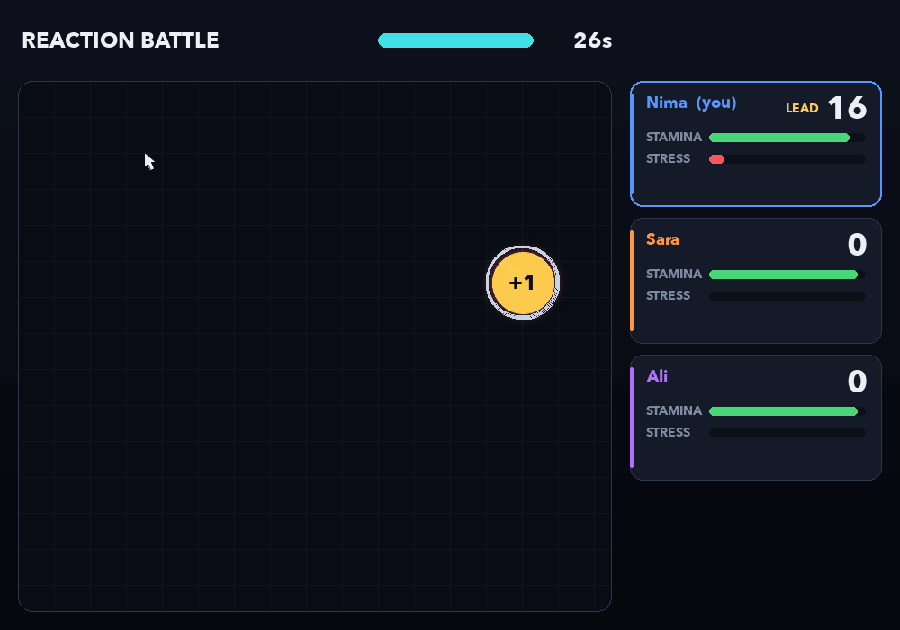
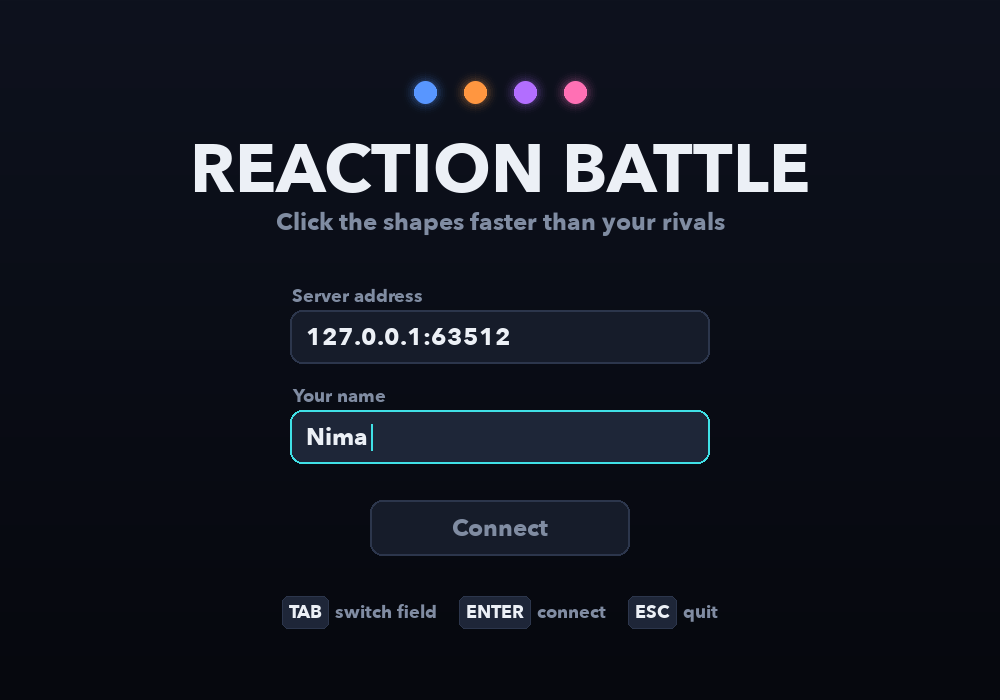
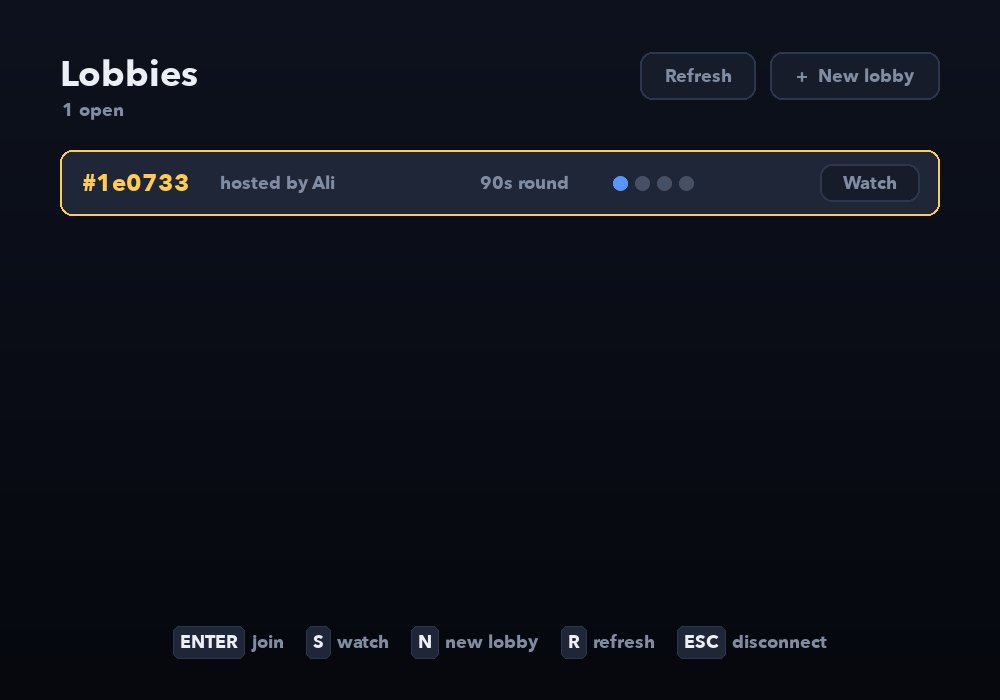
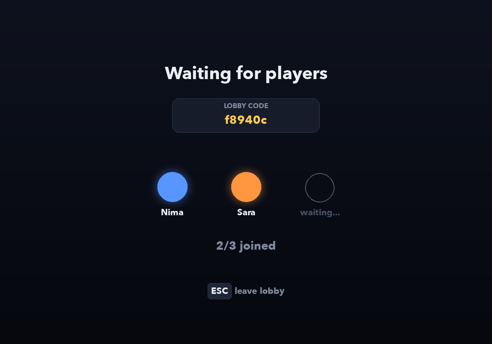
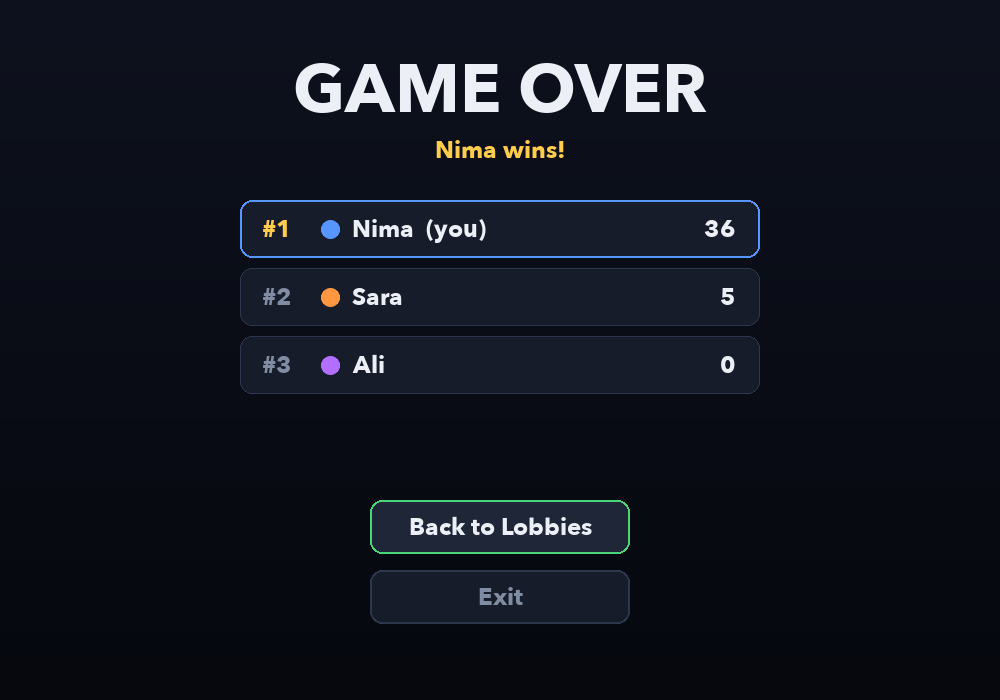

# Reaction Battle

A real-time multiplayer game where 2 to 4 players race to click shapes before anyone else does, over a plain TCP connection.



## About

I built this for the **Advanced Programming** course at the **University of Guilan** (Spring 2026, Feb – Jul 2026). The point of the project was networking and concurrency: one server keeps the real game state, every client is just a window that sends clicks and draws whatever the server says is happening.

The twist is that you are not only fighting the other players, you are also fighting yourself. Clicking costs stamina, missing raises your stress, and the more stressed you get the harder your own cursor is to control.

## Features

- Lobby system: create a lobby (2–4 players, 30–120 second rounds), join one, or just watch as a spectator
- Authoritative server, so clients can't cheat by changing their own score
- Shapes with different rules
  - **normal** shapes give or take points (+6 down to −3)
  - **shield** protects you from negative points for 5 seconds
  - **ice** freezes every other player for 3 seconds
- Stamina and stress
  - low stamina dims your screen and hides some shapes from you, and below 10 you can't click at all until you rest
  - high stress slows your cursor, makes it jump randomly, leaves a trail and shows fake shapes only you can see
  - the client measures your normal mouse speed in the first two seconds and corrects for it, so turning up your mouse sensitivity mid-round doesn't get you out of the slowdown
- Players who disconnect mid-round keep their score on the result screen
- Score pop-ups, click ripples and a countdown before each round

## How it works

```
 client (pygame)                     server
 ┌──────────────┐   click x,y        ┌──────────────────────────┐
 │ reader thread│ ─────────────────▶ │ one thread per client    │
 │  + queue     │                    │                          │
 │              │ ◀───────────────── │ broadcast thread, 20/s:  │
 │ draw loop    │   state snapshot   │  update every session,   │
 └──────────────┘                    │  send each viewer its    │
                                     │  own snapshot            │
                                     └──────────────────────────┘
```

- Messages are JSON objects, one per line (`shared/protocol.py`). A small buffer on each side splits the TCP stream back into whole messages.
- The server runs a thread per connected client plus one broadcast thread. Each `GameSession` has its own lock, since clicks and the broadcast loop touch it at the same time.
- Every player gets a *personal* snapshot: hidden shapes and illusions differ per player, so the server builds the view for each viewer instead of sending one shared state.
- On the client a background thread reads from the socket and puts messages in a queue, and the pygame loop drains that queue every frame, so the window never freezes waiting for the network.

## Getting started

You need Python 3.10 or newer.

```bash
pip install -r requirements.txt
```

Start the server:

```bash
python server.py
```

Then start one client per player (in different terminals or on different machines):

```bash
python client.py
```

To play over a local network, run the server with `--host 0.0.0.0` and type the server machine's IP in the client. Both programs also take `--port`, and the client takes `--name` to fill in your name.

## Controls

| Where | Keys |
| --- | --- |
| Connect screen | type, `TAB` to switch field, `ENTER` to connect |
| Lobby list | `ENTER` join, `S` watch, `N` new lobby, `R` refresh (or just click) |
| In game | move the mouse and click shapes, `ESC` to leave |

## Project structure

```
server.py            server: accepts clients, routes messages, broadcasts state
client.py            pygame client: screens, input, talking to the server
shared/
  protocol.py        newline-delimited JSON over a socket
  constants.py       game rules, timings and message names (shared by both sides)
game/
  session.py         one match: lobby, countdown, spawning, clicks, results
  models.py          player state, stamina and stress
  shapes.py          the shape types and what happens when you click them
frontend/
  network.py         socket reader thread and send helpers
  cursor.py          the stress-affected cursor
  screens.py         connect, lobby, waiting and result screens
  hud.py             the in-game screen
  effects.py         pop-ups, ripples and flashes
  drawing.py         small drawing helpers
  theme.py           colors and fonts
```

## Screenshots

| | |
| --- | --- |
|  |  |
|  |  |

## License

[MIT](LICENSE)
